# msdfr

[](https://github.com/Azazel-Labs/Glyst/actions/workflows/ci.yml)
· [Live web demo](https://azazel-labs.github.io/Glyst/) (WebGPU)

A pure Rust generator of signed distance fields for vector shapes and font glyphs:
true SDF, pseudo-SDF, **multi-channel SDF (MSDF)** and **MSDF with the true SDF in alpha (MTSDF)**.
It is based on Viktor Chlumský's multi-channel method ([msdfgen](https://github.com/Chlumsky/msdfgen)),
and can also generate the fields on the GPU at run time and draw text with them.

It is a from-scratch reimplementation, not a port. It uses the same selection rules, so given
the same colored shape its output matches msdfgen's bit for bit, but it searches faster,
computes exact cubic distances, preprocesses outlines more robustly and has no C dependencies.

| Crate | What it is |
|---|---|
| [`msdfr`](crates/msdfr) | The library: shapes, edge coloring, SDF/PSDF/MSDF/MTSDF generation, error correction, font/SVG/shape-description input, PNG & co. output. No required dependencies (`ttf-parser` for fonts and `bytemuck` for the `gpu` feature, both optional). No `unsafe`. |
| [`msdfr-atlas`](crates/msdfr-atlas) | Font atlases on top of `msdfr`, in the role of [msdf-atlas-gen](https://github.com/Chlumsky/msdf-atlas-gen): charsets, glyph boxes, packing, parallel generation, JSON/CSV layouts in msdf-atlas-gen's format. Depends only on `msdfr`. |
| [`msdfr-cli`](crates/msdfr-cli) | The `msdfr` and `msdfr-atlas` command line tools ([clap](https://crates.io/crates/clap)); also accept msdfgen / msdf-atlas-gen's single-dash options. |
| [`msdfr-gpu`](crates/msdfr-gpu) | The same fields generated on the GPU with wgpu 30 compute shaders (native and WebGPU), a glyph atlas that picks each glyph's field resolution from the size it is drawn at, text shaping, and an MSDF text renderer. The only crate that depends on wgpu. |

```
cargo install --path crates/msdfr-cli
msdfr msdf --font MyFont.ttf A -o a.png --size 32 32 --pxrange 4 --autoframe --testrender preview.png 512 512
msdfr-atlas --font MyFont.ttf --type msdf --size 32 --pxrange 4 --imageout atlas.png --json atlas.json
# msdfgen / msdf-atlas-gen style works too:
msdfr msdf -font MyFont.ttf 'A' -o a.png -size 32 32 -pxrange 4 -autoframe
```

## How it works

A font stores each letter as an outline: lines and curves. To draw text fast, a GPU wants
small textures, but a plain bitmap of a letter blurs or turns blocky when it is scaled up.
A **signed distance field** stores something else in each texel: how far that point is from
the outline, positive inside and negative outside. When text is drawn, the GPU blends
between texels, which works smoothly for distances, and draws ink wherever the distance is
above zero. The edge comes out sharp at any size, and outlines, glows and shadows come free:
they are just other distance thresholds.

One distance has a weakness: a texel near a sharp corner is equally close to both sides of
it, so corners come out rounded. The **multi-channel** method stores three distances, to
different subsets of the edges, in the red, green and blue channels. Drawing takes the
middle value (the median) of the three, and that reconstructs sharp corners.

Everything below is drawn from the generator's real output by
[`examples/figures.rs`](examples/figures.rs) (`cargo run --release --bin figures`).

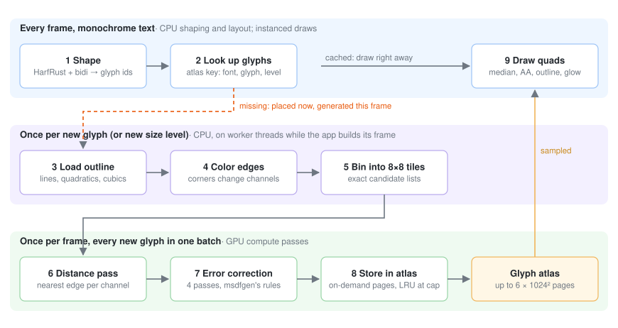

The library runs in three tiers. Every frame, text is shaped into glyphs, and each glyph is
looked up in the atlas, a texture cache of fields. A glyph that is already there is drawn
right away. A missing glyph gets its place in the atlas immediately. Its outline is prepared
on worker threads (steps 3–5), and the GPU generates every glyph missing in that frame in
one batch (steps 6–8), so new text appears the frame it is first drawn.

### Coloring the edges

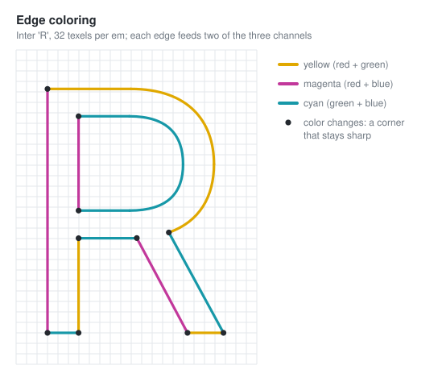

The outline is split at its corners, and each piece gets a color. A color names the channels
the edge contributes to: yellow edges count for red and green, cyan for green and blue, and
so on. Two edges that meet at a sharp corner never share all their channels. Near the corner,
each channel therefore sees only one of the two sides, and the median of the three keeps the
corner sharp.

### Binning edges into tiles

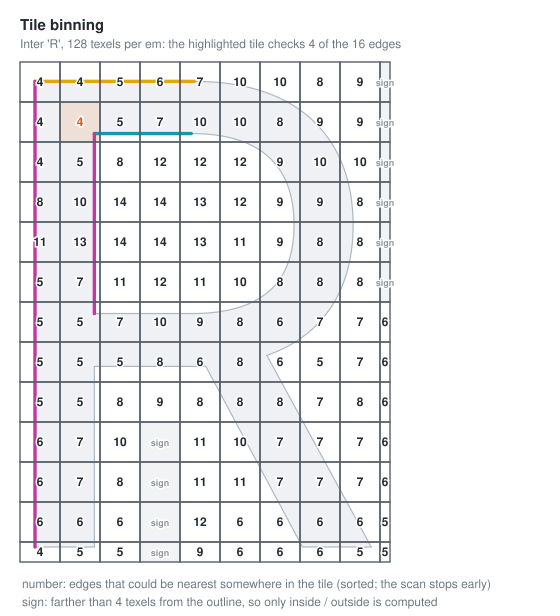

Finding the nearest edge for every texel by checking every edge is wasteful: most edges are
far away. Before the GPU starts, the CPU splits the field into 8×8 texel tiles. For each tile
it computes an upper bound on the nearest distance, and keeps only the edges that could get
closer than that bound. The lists are sorted, so the GPU stops scanning as soon as no
remaining edge can win. The culling is exact: an edge that could be the nearest anywhere in
the tile is never dropped. Tiles far from the outline only need to know whether they are
inside or outside.

### The field

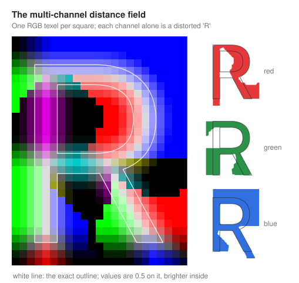

The compute shader evaluates the exact distance to each candidate: lines in closed form, and
curves by solving for the nearest point on the curve, never by cutting them into short
lines. Each channel on its own is a distorted R with bulging corners. Where two channels
agree, the median follows the true outline.

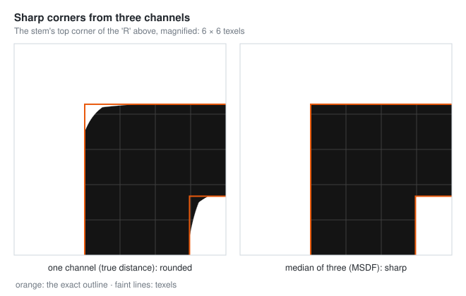

Magnified, the difference is plain. A single distance channel rounds the corner off; the
median of three keeps it square, even from a 32 texels per em field.

### Error correction

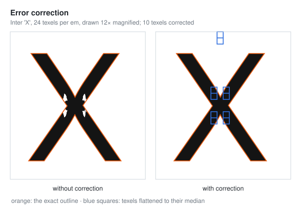

Where channels cross between two texels, blending can make the median wrong and leave a dent
or spur in the glyph. Error correction finds those texels, using msdfgen's rules plus exact
distance checks, and flattens them to their median: they lose the sharp corner but stop
causing artifacts. On the GPU this is four more passes over the same batch.

### Inside a GPU batch

All the glyphs that are new in a frame are generated together, in one set of buffers and one
dispatch per pass. Each storage buffer is the concatenation of every glyph's part of it. A
glyph's own record (binding 0) says where its parts start, so one shader invocation can find
everything about its glyph from a glyph index alone.

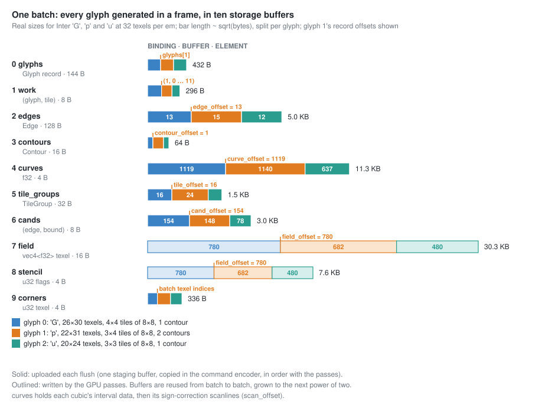

- The CPU fills the solid buffers: the records, the work list, the outline (edges, contours,
  and curve data for cubics and the sign-correction scanlines), and the tile binning
  (candidate lists and their bounds). They go up through one staging buffer, copied inside the
  command encoder. Uploads therefore land in order with the passes that read them, and a frame
  may flush any number of batches before it submits.
- The GPU writes the outlined buffers: the field (one `vec4` per texel) and the error
  correction's per-texel flags.
- Buffers persist from batch to batch and grow to the next power of two. Frames without new
  glyphs allocate nothing; a flush with new glyphs creates only its staging buffer.

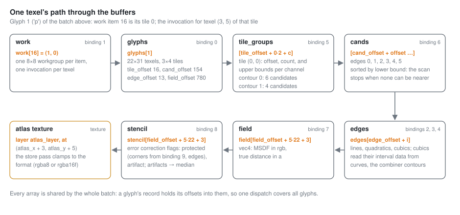

The work list has one entry per tile of every glyph, `(glyph, tile)`. Each entry becomes one
8×8 workgroup, and each invocation in it computes one texel. From the glyph record, the
invocation finds:
1. its tile's group records: one per contour, with upper bounds on the distance per channel;
2. the candidate edges of each group, sorted by a lower bound, so the scan stops once no
   remaining edge can be nearer;
3. those edges;
4. the field texel it writes.

The atlas store pass then copies that texel into the glyph's rectangle of the texture array.

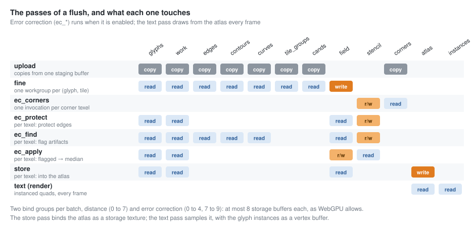

A flush runs these passes in order:
1. the upload;
2. the distance pass;
3. four error correction passes, when error correction is on. They share the field and a
   per-texel stencil of flags: protect the corner texels, protect texels at edges, flag
   artifacts, then flatten the flagged texels to their median.
4. the store into the atlas.

The bindings form two bind groups, distance and error correction, so neither exceeds WebGPU's
limit of 8 storage buffers per pass. Drawing text is separate and runs every frame: an
instanced quad per glyph samples the atlas, whether or not anything was generated.

### The atlas

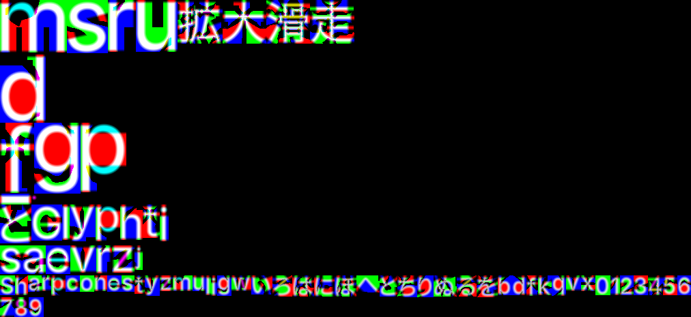

Generated fields go into a texture array: four 1024 × 1024 layers by default, with the true
distance in the alpha channel (MTSDF). Each glyph is generated at a resolution chosen from
the size it is drawn at: 32, 64 or 128 texels per em. Small text gets small fields, large
text gets detail, and one glyph can be cached at several sizes. When the atlas is full, the
least recently used layer is cleared and reused. Glyphs with a wide glow or shadow get a
field with a wider distance range, so effects never clip.

### Shaping

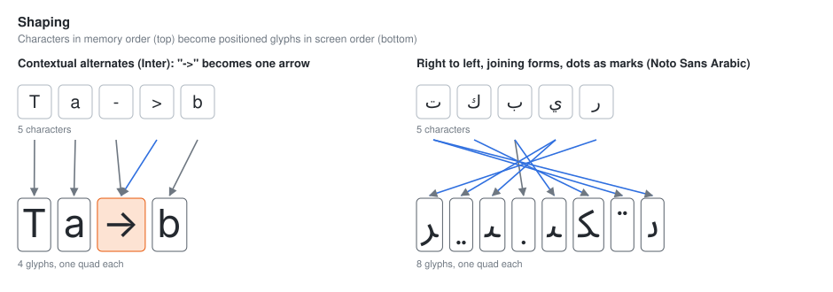

Characters are not glyphs. [HarfRust](https://github.com/harfbuzz/harfrust), the HarfBuzz
project's Rust port, turns a line of text into positioned glyphs. It joins letters,
substitutes ligatures and contextual forms, positions marks and applies kerning. The Unicode
bidi algorithm first puts right-to-left runs into screen order. Each glyph then becomes one
textured quad. Its shader takes the median of the three channels and anti-aliases the edge
in screen space, and it can add weight, outlines, glows and soft shadows from the same
field.

## Better / faster / stronger

**Faster:** 3.2–3.9× faster than msdfgen 1.13 single-threaded for MSDF/MTSDF, more with threads:

| Workload (94 printable ASCII glyphs, error correction on) | msdfgen | msdfr | speedup |
|---|---:|---:|---:|
| DejaVu Sans (TrueType) MSDF 32 px, 1 thread | 144.9 ms | 36.7 ms | **3.9×** |
| DejaVu Sans MSDF 64 px, 1 thread | 436.9 ms | 111.6 ms | **3.9×** |
| DejaVu Sans MTSDF 32 px, 1 thread | 146.0 ms | 37.0 ms | **3.9×** |
| DejaVu Sans SDF 32 px, 1 thread | 34.0 ms | 14.9 ms | 2.3× |
| Inter Regular (CFF / cubic) MSDF 32 px, 1 thread | 158.3 ms | 42.0 ms | **3.8×** |
| Inter Regular MSDF 64 px, 1 thread | 492.0 ms | 134.8 ms | **3.7×** |
| Inter Regular SDF 32 px, 1 thread | 50.3 ms | 20.6 ms | 2.4× |
| Atlas: DejaVu MSDF 32 px, 2 threads (msdfgen: OpenMP; msdfr: `par_map`) | 88.1 ms | 18.7 ms | **4.7×** |
| Large: DejaVu MSDF 256 px, 2 threads in each glyph | 3055 ms | 788 ms | **3.9×** |

<sub>2-core Intel Xeon @ 2.1 GHz VM, msdfgen built with `-O3` and OpenMP (`OMP_NUM_THREADS=1`
for the single-thread rows), same shapes, same "simple" edge coloring, best of several runs.
msdfr side: `cargo bench -p msdfr`.</sub>

Where the speed comes from (none of it changes results):
* **Exact culling.** Each 8×8 tile computes provable upper bounds of the nearest distance per
  channel and drops edges that can't beat them; per texel, edges are rejected by bounding-box
  and corner-extension lower bounds against the current best. Only ~1–3 edges per texel get a
  full distance evaluation (msdfgen evaluates every edge).
* **Spatial coherence.** The nearest edges of the previous texel are evaluated first so the
  bounds are tight immediately; texels are visited in serpentine order. Curve kernels start
  Newton at the parameter found for the previous texel.
* **Lean distance kernels.** Precomputed per-edge data (reciprocal lengths for lines, power-basis
  coefficients for quadratics; for cubics the Bernstein coefficients of the point-independent
  parts of the distance derivative on every sample interval, so a query needs 12 multiply-adds
  per interval instead of a basis conversion). No allocation or large stack initialization per
  call; Newton stops once its step is below 1e-9 (the squared distance is stationary there).
* **Vectorized error correction.** Exact, conservative prefilters run over the whole field as
  flat, branchless structure-of-arrays loops that the compiler vectorizes (build with
  `-C target-cpu=native` to let it use AVX2 and wider). Each texel pair and 2×2 cell is tested
  once for channel crossings, and the scalar artifact tests only visit the few neighbor
  directions and channel pairs that pass. Edge protection likewise only looks at pairs near
  the edge where a channel crosses zero. The exact-distance check only revisits texels the
  base scan flagged, so msdfgen's default "auto" mode costs almost nothing extra.
* **Built-in threading** across rows of large outputs and a `par_map` helper for atlases.

**Stronger:** exactness and robustness.
* *Bit-identical to msdfgen* for TrueType fonts in all four modes and all error-correction
  modes when given the same colored shape (3 fonts × 94 glyphs × 4 modes, ~6 M values,
  0 differences; CFF fonts within 2.4e-7).
* *Exact cubic distance.* msdfgen finds the nearest point on a cubic with a few Newton
  iterations from fixed starts, which can miss tight curves. msdfr isolates the roots of the
  distance derivative in Bernstein form (Descartes' rule of signs) with rigorous pruning
  bounds. The `cubic_kernel_matches_brute_force` test checks it against brute force: 0 misses
  in 8.6 M queries on the cubic edges of two CFF fonts. On random curvy cubic shapes, msdfgen
  had 36 of 57 600 texels off by more than 0.01 px (worst 1.89 px); msdfr had none (worst
  0.0004 px, which is the sampling error of the ground truth).
* *Contour orientation fixing* by fill rule (non-zero / even-odd) before generation, so
  TrueType (clockwise) and PostScript/CFF (counter-clockwise) outlines, SVG paths and hand-made
  shapes all work without relying on per-texel sign repair.
* *Tie-safe culling*: bounds use a relative margin so exact ties at corners are still decided
  by the orthogonality rule rather than by rounding.
* Cusps are deconverged toward the side each curve actually bends to; zero-length edges are dropped.

**Better:** defaults and features.
* Ink-trap-aware edge coloring by default: fewer visible artifacts than msdfgen's CLI default
  (pixels off by > 0.5 when rendered at 8×, vs. exact rasterization, all printable ASCII):

  | | msdfgen default | msdfr default |
  |---|---:|---:|
  | DejaVu Sans 24 px, range 3 | 365 | **304** |
  | DejaVu Sans 32 px, range 4 | 75 | **67** |
  | Inter 24 px, range 3 | 598 | **411** |
  | Inter 32 px, range 4 | 319 | **187** |

  (msdfgen with `-coloringstrategy inktrap` gets 285 / 67 / 400 / 187: the field
  generation itself is equivalent; the gain is the default.)
* Zero required dependencies; font loading uses the pure-Rust `ttf-parser` (optional
  `font` feature, on by default) including CFF2 and variable fonts (`-fontvar wght=700`).
* SVG input with all path commands (including arcs), `<rect>`, `<circle>`, `<ellipse>`,
  `<polygon>`, nested `<g>` transforms, `fill-rule`, `display:none` / `fill="none"`, and the
  union of all shapes (msdfgen without Skia uses only the last path).
* Built-in PNG output with its own deflate (lazy-matching LZ77, dynamic Huffman blocks,
  parallel chunks for large images), giving atlases 25–30% smaller than
  msdf-atlas-gen's, plus BMP, FL32, RGBA, raw and text output.
* `msdfgen`-compatible text shape descriptions (read and write) and command line.

## Font atlases (`msdfr-atlas`)

Same job and output format as msdf-atlas-gen, so existing loaders and shaders work unchanged:
the JSON has the same `atlas` / `metrics` / `glyphs` (`planeBounds` in ems, `atlasBounds` in
pixels) / `kerning` structure and values, and text rendered from either atlas is visually
identical (mean coverage difference 0.0005).

| Atlas (MSDF, 32 px/em, range 4 px) | msdf-atlas-gen | msdfr-atlas | speedup |
|---|---:|---:|---:|
| DejaVu Sans, all 6 253 glyphs, 1 thread | 22.2 s | 4.4 s | **5.1×** |
| DejaVu Sans, all 6 253 glyphs, 2 threads | 16.8 s | 2.6 s | **6.6×** |
| Inter Regular (CFF), all glyphs, 1 thread | 7.9 s | 2.0 s | **3.9×** |
| Inter Regular, all glyphs, 2 threads | 5.5 s | 1.2 s | **4.6×** |
| DejaVu Sans ASCII MTSDF 48 px/em, 2 threads | 189 ms | 50 ms | **3.8×** |

<sub>Wall-clock time of the command line tools including font loading and writing PNG + JSON.</sub>

Features: charsets in msdf-atlas-gen syntax (`'A'`, `"text"`, `0x41`, `[0x20, 0x7e]`; files
or inline `--chars`), glyph-index sets and `--allglyphs`; atlas types hardmask, softmask, sdf,
psdf, msdf, mtsdf; fixed `--dimensions` (the glyph size is then maximized) or automatic
dimensions with `--pots`, `--potr`, `--square`, `--square2`, `--square4` (default), `--anydims`;
pixel or em ranges (also asymmetric), padding, spacing, miter room for sharp corners, pixel
alignment, uniform grids (`--uniformgrid`, `--uniformcols`, `--uniformcell`), `--yorigin`,
kerning, variable fonts and every msdfr generator option. Packing uses MaxRects for small sets
and a skyline packer for large ones, with a bisection search for the smallest dimensions.

```rust
use msdfr_atlas::*;

let data = std::fs::read("font.ttf")?;
let font = FontGeometry::load(&data, 0, &[], &GlyphSelection::Charset(Charset::ascii()), &GlyphOptions::default())?;
let config = AtlasConfig { size: Some(32.0), range: RangeSpec::Pixels(msdfr::Range::symmetric(4.0)), ..AtlasConfig::default() };
let atlas = generate(&font, &config)?;
atlas.image.save("atlas.png", msdfr::io::ImageFormat::Png)?;
std::fs::write("atlas.json", layout::to_json(&font, &atlas.layout, &config))?;
```

## GPU generation (`msdfr-gpu`)

For apps that generate glyph fields at run time (see [How it works](#how-it-works)). The
CPU bins each glyph's edges into 8×8 tiles with exact culling bounds, and WGSL compute passes
evaluate every texel of all the glyphs requested in a frame in one batch. msdfr's selection
rules, overlapping contour combiner and error correction are all included, and the output
matches the CPU's to about 3·10⁻⁶, apart from exact ties. `GlyphAtlas` caches glyphs in a
texture array at power-of-two levels chosen from the displayed size, and `TextRenderer`
draws them. See [its README](crates/msdfr-gpu/README.md) and the
[web demo](examples/web-demo).

```
cargo run --release --bin text_demo -- examples/web-demo/assets/Inter-Regular.otf
```

## Library

```rust
use msdfr::*;
use msdfr::io::font::{Font, FontScaling};

let data = std::fs::read("MyFont.ttf")?;
let font = Font::from_bytes(&data, 0, FontScaling::EmNormalized)?;
let mut shape = font.glyph('A')?.shape;

shape.normalize();
shape.orient_contours(FillRule::NonZero);
edge_coloring(&mut shape, ColoringStrategy::InkTrap, DEFAULT_ANGLE_THRESHOLD, 0);

// 32x32 texels, shape units (ems) -> texels: (p + translate) * scale, 0.125 em range.
let transform = Transform::new(Projection::uniform(32.0, Vec2::new(0.125, 0.125)), Range::symmetric(0.125));
let mut msdf = Bitmap::<3>::new(32, 32);
generate_msdf(&mut msdf, &shape, &transform, &GeneratorConfig::default());
msdfr::io::save_png(&msdf, "a.png")?;
```

* Generators: `generate_sdf`, `generate_psdf`, `generate_msdf`, `generate_mtsdf` (and
  `*_prepared` variants that reuse a `PreparedShape`).
* `GeneratorConfig`: `overlap_support` (default on), `error_correction` (msdfgen's modes:
  `EdgePriority`/`Indiscriminate`/`EdgeOnly` × distance check never/at edges/always),
  `sign_correction: Option<FillRule>` (scanline pass), `threads` (0 = automatic).
* Shapes: build from `Edge::line` / `Edge::quadratic` / `Edge::cubic`, parse with
  `Shape::from_description`, load SVG with `io::svg::load_svg`, glyphs with `io::font::Font`.
* Coordinates are y-up; set `shape.inverse_y_axis` for y-down data (SVG loading does this).
  `Bitmap` rows are stored top-to-bottom (image order); `save_fl32` writes msdfgen's bottom-up layout.
* `Transform::autoframe(bounds, w, h, px_range)` mirrors msdfgen's `-autoframe`.
* `render_sdf`, `render_sdf_multi` and `rasterize` for previews and testing.
* `par_map(&items, threads, f)` for building atlases in parallel.

Rendering an MSDF works as usual: sample, take the median of the three channels, and use
`screenPxRange() * (median - 0.5)` as the signed distance in screen pixels.

## Command line

Both tools are built with clap (`--help` lists everything, grouped by topic). Option names
follow msdfgen / msdf-atlas-gen, and their single-dash spelling (`-pxrange 4`) is rewritten to
`--pxrange 4` before parsing, so existing scripts keep working.

`msdfr [sdf|psdf|msdf|mtsdf|metrics] <input> [options]`. Inputs:
`--font <file> <char>` (`'A'`, `65`, `0x41`, or glyph index `g36`), `--svg <file>`,
`--shapedesc <file>`, `--defineshape "<desc>"`, `--stdin`. Common options: `-o`, `--size`/`--dimensions`,
`--pxrange`, `--range`, `--scale`, `--translate`, `--autoframe`, `--angle`, `--coloringstrategy`,
`--errorcorrection`, `--fillrule`, `--testrender`, `--exportshape`, `--printmetrics`, `--threads`, `--stats`.

`msdfr-atlas --font <file> [--charset <file> | --chars <spec> | --glyphset <file> | --allglyphs] --imageout <file> [--json <file>] [--csv <file>] [options]`.

Differences from msdfgen's defaults: ink-trap coloring, contour reorientation (`-noorient`
to disable) and the "auto" error correction mode even with the scanline pass (msdfgen falls
back to "auto-fast"); the scanline pass downgrades to "auto-fast" only if it actually had to
flip signs.
