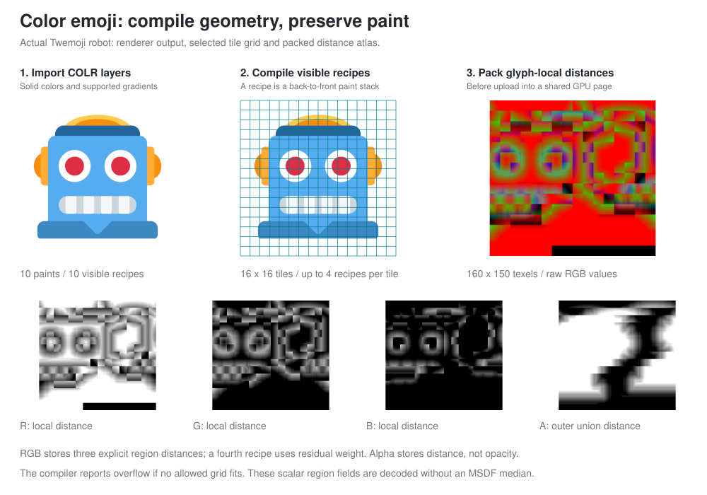
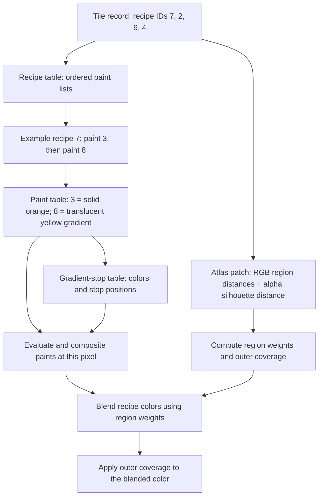
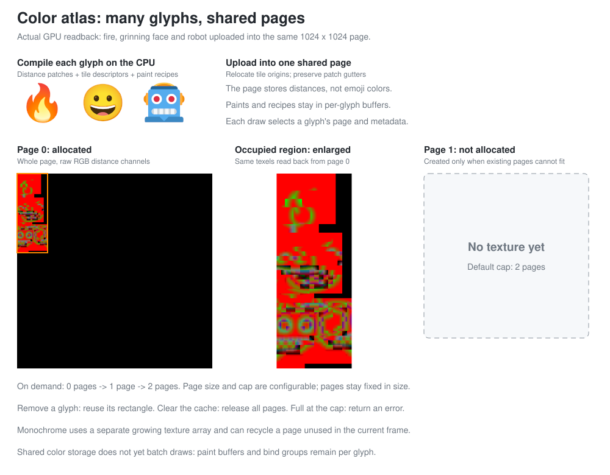
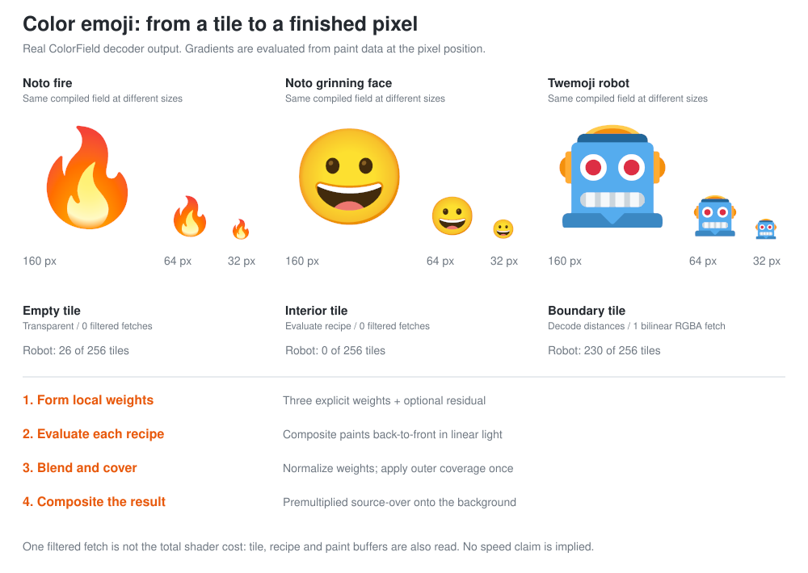

# Glyphux

[](https://github.com/Azazel-Labs/Glyphux/actions/workflows/ci.yml)
· [Live web demo](https://azazel-labs.github.io/Glyphux/) ([WebGPU](https://www.w3.org/TR/webgpu/))

Glyphux builds on Viktor Chlumský's [msdfgen](https://github.com/Chlumsky/msdfgen) method:
store distances to a shape's edges in a small texture, then use those distances to draw
sharp text at different sizes. It began as a from-scratch Rust implementation and has
grown into a text rendering system with GPU generation, worker threads and color emoji.

- **Faster generation.** The CPU skips edges that cannot affect a pixel and splits work
  across threads. Single-threaded MSDF/MTSDF generation is 3.2 to 3.9× faster than
  msdfgen 1.13 in the [benchmarks below](#better--faster--stronger).
- **Generate and draw as needed.** Native worker threads prepare missing glyphs; the
  GPU generates their distance fields together and stores them on shared atlas pages.
  Pages grow on demand up to a configurable limit. The renderer runs on native GPUs
  and WebGPU; the web build currently does CPU preparation on the calling thread.
- **More than basic Latin text.** Text shaping handles ligatures, joined scripts and
  right-to-left text. Font loading supports variable fonts and CFF2 outlines, alongside
  SVG shapes. The Rust implementation has no C dependencies.
- **Color emoji from shapes and paints.** Supported
  [COLRv0 and COLRv1](https://learn.microsoft.com/en-us/typography/opentype/spec/colr)
  fonts become distance fields on shared color atlas pages, plus tables of solid colors
  and gradients. The shader combines them while drawing, so emoji can move, rotate and
  scale with the rest of the text. See [how color emoji work](#color-emoji).

The generator supports true SDF, pseudo-SDF, **multi-channel SDF (MSDF)** and
**MSDF with the true SDF in alpha (MTSDF)**, for both font glyphs and vector shapes.

<table>
  <thead>
    <tr><th width="180">Crate</th><th>What it is</th></tr>
  </thead>
  <tbody>
    <tr>
      <td><a href="crates/glyphux"><code>glyphux</code></a></td>
      <td>The library: shapes, edge coloring, SDF/PSDF/MSDF/MTSDF generation, error correction, font/SVG/shape-description input, PNG &amp; co. output. No required dependencies (<code>ttf-parser</code> for fonts and <code>bytemuck</code> for the <code>gpu</code> feature, both optional). No <code>unsafe</code>.</td>
    </tr>
    <tr>
      <td><a href="crates/glyphux-atlas"><code>glyphux-atlas</code></a></td>
      <td>Font atlases on top of <code>glyphux</code>, in the role of <a href="https://github.com/Chlumsky/msdf-atlas-gen">msdf-atlas-gen</a>: charsets, glyph boxes, packing, parallel generation, JSON/CSV layouts in msdf-atlas-gen's format. Depends only on <code>glyphux</code>.</td>
    </tr>
    <tr>
      <td><a href="crates/glyphux-cli"><code>glyphux-cli</code></a></td>
      <td>The <code>glyphux</code> and <code>glyphux-atlas</code> command line tools (<a href="https://crates.io/crates/clap">clap</a>); also accept msdfgen / msdf-atlas-gen's single-dash options.</td>
    </tr>
    <tr>
      <td><a href="crates/glyphux-gpu"><code>glyphux-gpu</code></a></td>
      <td>The same fields generated on the GPU, independent of the graphics API: a glyph atlas that picks each glyph's field resolution from the size it is drawn at, the batches and WGSL of the compute kernels, text shaping and layout. Backends run it.</td>
    </tr>
    <tr>
      <td><a href="crates/glyphux-wgpu"><code>glyphux-wgpu</code></a></td>
      <td>The wgpu 30 backend (native and WebGPU): the atlas texture, the compute passes, and MSDF text and color glyph renderers. The only crate that depends on wgpu.</td>
    </tr>
  </tbody>
</table>

```
cargo install --path crates/glyphux-cli
glyphux msdf --font MyFont.ttf A -o a.png --size 32 32 --pxrange 4 --autoframe --testrender preview.png 512 512
glyphux-atlas --font MyFont.ttf --type msdf --size 32 --pxrange 4 --imageout atlas.png --json atlas.json
# msdfgen / msdf-atlas-gen style works too:
glyphux msdf -font MyFont.ttf 'A' -o a.png -size 32 32 -pxrange 4 -autoframe
```

## How it works

A font stores each letter as an outline: lines and curves. To draw text fast, a GPU wants
small textures, but a plain bitmap of a letter blurs or turns blocky when it is scaled up.
A **signed distance field** stores something else in each texture pixel (a texel): how far that point is from
the outline, positive inside and negative outside. When text is drawn, the GPU blends
between texels, which works smoothly for distances, and draws ink wherever the distance is
above zero. This keeps edges sharp over a wide range of sizes. The same stored distances
also let us draw outlines, glows and shadows by changing where ink starts or how it fades.

One distance has a weakness: a texel near a sharp corner is equally close to both sides of
it, so corners come out rounded. The **multi-channel** method stores three distances, to
different subsets of the edges, in the red, green and blue channels. Drawing takes the
middle value (the median) of the three, and that reconstructs sharp corners.

The monochrome figures below are drawn from the generator's real output by
[`examples/figures.rs`](examples/figures.rs) (`cargo run --release --bin figures`).


Every frame, we turn the text into glyphs: the individual shapes a font draws. We then
look up each glyph in the atlas, a set of texture pages holding fields we can reuse. A glyph that is already there is drawn
right away. A missing glyph gets its place in the atlas immediately. Its outline is prepared
on worker threads (steps 3 to 5), and the GPU generates every glyph missing in that frame in
one batch (steps 6 to 8), so new text appears the frame it is first drawn.

### Coloring the edges


The outline is split at its corners, and each piece gets a color. A color names the channels
the edge contributes to: yellow edges count for red and green, cyan for green and blue, and
so on. Two edges that meet at a sharp corner never share all their channels. Near the corner,
each channel therefore sees only one of the two sides, and the median of the three keeps the
corner sharp.

### Choosing which edges each tile needs


Finding the nearest edge for every texel by checking every edge is wasteful: most edges are
far away. Before the GPU starts, the CPU splits the field into 8×8 texel tiles. For each tile
it computes an upper bound on the nearest distance, and keeps only the edges that could get
closer than that bound. The lists are sorted, so the GPU stops scanning as soon as no
remaining edge can win. We only skip edges we can prove are too far away, so this does
not change the result. Tiles far from the outline only need to know whether they are
inside or outside.

### The field


For each remaining edge, the GPU calculates the distance to its nearest point. It uses
a direct formula for straight lines and solves for the nearest point on curves, rather
than approximating curves with short straight lines. Each channel on its own is a distorted R with bulging corners. Where two channels
agree, the median follows the true outline.


Magnified, the difference is plain. A single distance channel rounds the corner off; the
median of three keeps it square, even from a 32 texels per em field.

### Error correction


Where channels cross between two texels, blending can make the median wrong and leave a dent
or spur in the glyph. Error correction finds those texels, using msdfgen's rules plus exact
distance checks, and flattens them to their median: they lose the sharp corner but stop
causing artifacts. On the GPU this is four more passes over the same batch.

### Inside a GPU batch

All the glyphs that are new in a frame are generated together, in one set of buffers and one
GPU launch per processing step. A buffer is a table of values the GPU can read or write.
We place each glyph's entries after the previous glyph's entries in those tables. Another
table, the glyph records at binding 0, stores each glyph's starting positions and counts.
Given a glyph number, the GPU reads that record to find its edges, tiles and output space.


- The CPU fills the solid boxes in the diagram: glyph records, a list of tiles to process,
  outline data, and the edges each tile needs to check. It puts the upload in a temporary
  buffer and records its copy before the GPU commands that read it.
- The GPU writes the outlined boxes: four distance values per texture pixel (`vec4`),
  plus flags marking pixels that may need error correction.
- We reuse these working buffers between batches, enlarging them when necessary. Each
  batch with new glyphs gets a temporary upload buffer; an empty batch needs no upload.


The work list has one entry per tile of every glyph, `(glyph, tile)`. Each entry becomes one
group of 64 GPU workers, with each worker computing one texture pixel. From the glyph
record, each worker finds:
1. its tile's group records: one per contour, with upper bounds on the distance per channel;
2. the candidate edges of each group, sorted by a lower bound, so the scan stops once no
   remaining edge can be nearer;
3. those edges;
4. the field texel it writes.

The atlas store pass then copies that texel into the glyph's rectangle of the texture array.


A flush runs these passes in order:
1. the upload;
2. the distance pass;
3. four error correction passes, when error correction is on. They share the field and a
   table of flags, one entry per texture pixel: protect corners, protect edges, mark
   errors, then replace the marked pixels' three distances with their middle value.
4. the store into the atlas.

We give the distance and error-correction steps different sets of buffers, called bind
groups, so each stays within WebGPU's limit of eight storage buffers per pass. Drawing
text is separate: every frame, we draw a rectangle for each glyph and read its distances
from the atlas, whether those distances were just generated or already cached.

### The atlas


Generated fields go into a texture array: 1024 × 1024 pages allocated on demand, capped
at six by default (`AtlasConfig::layers`), with the true
distance in the alpha channel (MTSDF). Each glyph is generated at a resolution chosen from
the size it is drawn at: 32, 64 or 128 texels per em. Small text gets small fields, large
text gets detail, and one glyph can be cached at several sizes. When the atlas is full, the
least recently used layer not needed in the current frame is cleared and reused. Growing
the array preserves existing glyphs. Glyphs with a wide glow or shadow get a
field with a wider distance range, so effects never clip.

### Shaping


Characters are not glyphs. [HarfRust](https://github.com/harfbuzz/harfrust), the HarfBuzz
project's Rust port, turns a line of text into positioned glyphs. It joins letters,
substitutes ligatures and contextual forms, positions marks and applies kerning. The
[Unicode bidi algorithm](https://www.unicode.org/reports/tr9/) first puts right-to-left runs into screen order. Each glyph then becomes one
textured quad. Its shader takes the median of the three channels and anti-aliases the edge
in screen space, and it can add weight, outlines, glows and soft shadows from the same
field.

`Shaper` enables GPOS kerning and standard shaping features by default, including for
TrueType variable fonts. Set `shaper.features = vec!["-kern".parse()?]` to disable
kerning, or `shaper.language = Some("tr".parse()?)` to select a language system.
Feature ranges refer to UTF-8 byte offsets in the original line, across script and
bidirectional runs.

The low-level `Font::kerning`, `layout_line`, and static atlas kerning export use
legacy `kern` tables only. They combine additive and override pairs and support
class-based pairs, but do not flatten GPOS, contextual positioning, or mark placement
into a pair list. Use `Shaper::shape_line` followed by `layout_shaped` for modern text.
Automatic font fallback, line wrapping, and vertical text layout are not provided by
this single-line shaping API.

## Better / faster / stronger

**Faster:** 3.2 to 3.9× faster than msdfgen 1.13 single-threaded for MSDF/MTSDF, more with threads:

| Workload (94 printable ASCII glyphs, error correction on) | msdfgen | glyphux | speedup |
|---|---:|---:|---:|
| DejaVu Sans (TrueType) MSDF 32 px, 1 thread | 144.9 ms | 36.7 ms | **3.9×** |
| DejaVu Sans MSDF 64 px, 1 thread | 436.9 ms | 111.6 ms | **3.9×** |
| DejaVu Sans MTSDF 32 px, 1 thread | 146.0 ms | 37.0 ms | **3.9×** |
| DejaVu Sans SDF 32 px, 1 thread | 34.0 ms | 14.9 ms | 2.3× |
| Inter Regular (CFF / cubic) MSDF 32 px, 1 thread | 158.3 ms | 42.0 ms | **3.8×** |
| Inter Regular MSDF 64 px, 1 thread | 492.0 ms | 134.8 ms | **3.7×** |
| Inter Regular SDF 32 px, 1 thread | 50.3 ms | 20.6 ms | 2.4× |
| Atlas: DejaVu MSDF 32 px, 2 threads (msdfgen: OpenMP; glyphux: `par_map`) | 88.1 ms | 18.7 ms | **4.7×** |
| Large: DejaVu MSDF 256 px, 2 threads in each glyph | 3055 ms | 788 ms | **3.9×** |

<sub>2-core Intel Xeon @ 2.1 GHz VM, msdfgen built with `-O3` and OpenMP (`OMP_NUM_THREADS=1`
for the single-thread rows), same shapes, same "simple" edge coloring, best of several runs.
glyphux side: `cargo bench -p glyphux`.</sub>

Where the speed comes from (none of it changes results):
* **Exact culling.** Each 8×8 tile computes provable upper bounds of the nearest distance per
  channel and drops edges that can't beat them; per texel, edges are rejected by bounding-box
  and corner-extension lower bounds against the current best. Only about 1 to 3 edges per texel get a
  full distance evaluation (msdfgen evaluates every edge).
* **Spatial coherence.** The nearest edges of the previous texel are evaluated first so the
  bounds are tight immediately; texels are visited in serpentine order. Curve kernels start
  Newton at the parameter found for the previous texel.
* **Lean distance kernels.** Precomputed per-edge data (reciprocal lengths for lines, power-basis
  coefficients for quadratics; for cubics the Bernstein coefficients of the point-independent
  parts of the distance derivative on every sample interval, so a query needs 12 multiply-adds
  per interval instead of a basis conversion). No allocation or large stack initialization per
  call; Newton stops once its step is below 1e-9 (the squared distance is stationary there).
* **Vectorized error correction.** Exact, conservative prefilters run over the whole field as
  flat, branchless structure-of-arrays loops that the compiler vectorizes (build with
  `-C target-cpu=native` to let it use AVX2 and wider). Each texel pair and 2×2 cell is tested
  once for channel crossings, and the scalar artifact tests only visit the few neighbor
  directions and channel pairs that pass. Edge protection likewise only looks at pairs near
  the edge where a channel crosses zero. The exact-distance check only revisits texels the
  base scan flagged, so msdfgen's default "auto" mode costs almost nothing extra.
* **Built-in threading** across rows of large outputs and a `par_map` helper for atlases.

**Stronger:** exactness and robustness.
* *Bit-identical to msdfgen* for TrueType fonts in all four modes and all error-correction
  modes when given the same colored shape (3 fonts × 94 glyphs × 4 modes, ~6 M values,
  0 differences; CFF fonts within 2.4e-7).
* *Exact cubic distance.* msdfgen finds the nearest point on a cubic with a few Newton
  iterations from fixed starts, which can miss tight curves. glyphux isolates the roots of the
  distance derivative in Bernstein form (Descartes' rule of signs) with rigorous pruning
  bounds. The `cubic_kernel_matches_brute_force` test checks it against brute force: 0 misses
  in 8.6 M queries on the cubic edges of two CFF fonts. On random curvy cubic shapes, msdfgen
  had 36 of 57 600 texels off by more than 0.01 px (worst 1.89 px); glyphux had none (worst
  0.0004 px, which is the sampling error of the ground truth).
* *Contour orientation fixing* by fill rule (non-zero / even-odd) before generation, so
  TrueType (clockwise) and PostScript/CFF (counter-clockwise) outlines, SVG paths and hand-made
  shapes all work without relying on per-texel sign repair.
* *Tie-safe culling*: bounds use a relative margin so exact ties at corners are still decided
  by the orthogonality rule rather than by rounding.
* Cusps are deconverged toward the side each curve actually bends to; zero-length edges are dropped.

**Better:** defaults and features.
* Ink-trap-aware edge coloring by default: fewer visible artifacts than msdfgen's CLI default
  (pixels off by > 0.5 when rendered at 8×, vs. exact rasterization, all printable ASCII):

  | | msdfgen default | glyphux default |
  |---|---:|---:|
  | DejaVu Sans 24 px, range 3 | 365 | **304** |
  | DejaVu Sans 32 px, range 4 | 75 | **67** |
  | Inter 24 px, range 3 | 598 | **411** |
  | Inter 32 px, range 4 | 319 | **187** |

  (msdfgen with `-coloringstrategy inktrap` gets 285 / 67 / 400 / 187: the field
  generation itself is equivalent; the gain is the default.)
* Zero required dependencies; font loading uses the pure-Rust `ttf-parser` (optional
  `font` feature, on by default) including CFF2 and variable fonts (`-fontvar wght=700`).
* SVG input with all path commands (including arcs), `<rect>`, `<circle>`, `<ellipse>`,
  `<polygon>`, nested `<g>` transforms, `fill-rule`, `display:none` / `fill="none"`, and the
  union of all shapes (msdfgen without Skia uses only the last path).
* Built-in PNG output with its own deflate (lazy-matching LZ77, dynamic Huffman blocks,
  parallel chunks for large images), giving atlases 25 to 30% smaller than
  msdf-atlas-gen's, plus BMP, FL32, RGBA, raw and text output.
* `msdfgen`-compatible text shape descriptions (read and write) and command line.

## Font atlases (`glyphux-atlas`)

Same job and output format as msdf-atlas-gen, so existing loaders and shaders work unchanged:
the JSON has the same `atlas` / `metrics` / `glyphs` (`planeBounds` in ems, `atlasBounds` in
pixels) / `kerning` structure and values, and text rendered from either atlas is visually
identical (mean coverage difference 0.0005).

| Atlas (MSDF, 32 px/em, range 4 px) | msdf-atlas-gen | glyphux-atlas | speedup |
|---|---:|---:|---:|
| DejaVu Sans, all 6 253 glyphs, 1 thread | 22.2 s | 4.4 s | **5.1×** |
| DejaVu Sans, all 6 253 glyphs, 2 threads | 16.8 s | 2.6 s | **6.6×** |
| Inter Regular (CFF), all glyphs, 1 thread | 7.9 s | 2.0 s | **3.9×** |
| Inter Regular, all glyphs, 2 threads | 5.5 s | 1.2 s | **4.6×** |
| DejaVu Sans ASCII MTSDF 48 px/em, 2 threads | 189 ms | 50 ms | **3.8×** |

<sub>Wall-clock time of the command line tools including font loading and writing PNG + JSON.</sub>

Features: charsets in msdf-atlas-gen syntax (`'A'`, `"text"`, `0x41`, `[0x20, 0x7e]`; files
or inline `--chars`), glyph-index sets and `--allglyphs`; atlas types hardmask, softmask, sdf,
psdf, msdf, mtsdf; fixed `--dimensions` (the glyph size is then maximized) or automatic
dimensions with `--pots`, `--potr`, `--square`, `--square2`, `--square4` (default), `--anydims`;
pixel or em ranges (also asymmetric), padding, spacing, miter room for sharp corners, pixel
alignment, uniform grids (`--uniformgrid`, `--uniformcols`, `--uniformcell`), `--yorigin`,
kerning, variable fonts and every glyphux generator option. Packing uses MaxRects for small sets
and a skyline packer for large ones, with a bisection search for the smallest dimensions.

```rust
use glyphux_atlas::*;

let data = std::fs::read("font.ttf")?;
let font = FontGeometry::load(&data, 0, &[], &GlyphSelection::Charset(Charset::ascii()), &GlyphOptions::default())?;
let config = AtlasConfig { size: Some(32.0), range: RangeSpec::Pixels(glyphux::Range::symmetric(4.0)), ..AtlasConfig::default() };
let atlas = generate(&font, &config)?;
atlas.image.save("atlas.png", glyphux::io::ImageFormat::Png)?;
std::fs::write("atlas.json", layout::to_json(&font, &atlas.layout, &config))?;
```

## GPU generation (`glyphux-gpu`, `glyphux-wgpu`)

For apps that generate glyph fields while running (see [How it works](#how-it-works)).
The CPU splits each field into 8×8 tiles and lists the edges each tile needs to check.
The GPU calculates distances for all newly requested glyphs together, then corrects
errors and writes the results into the atlas. Its output matches the CPU's to about
3·10⁻⁶, apart from ties where two edges are equally close. `GlyphAtlas` keeps fields
at resolutions suited to the displayed text size; `TextRenderer` draws them.
[glyphux-gpu](crates/glyphux-gpu/README.md) holds everything independent of the graphics
API; backends run it, such as [glyphux-wgpu](crates/glyphux-wgpu/README.md) (used by the
[web demo](examples/web-demo)).

```
cargo run --release --bin text_demo -- examples/web-demo/assets/Inter-Regular.otf
```

## Library

### Color emoji

A color font can describe an emoji as several shapes, each filled with a solid color
or a gradient. We read supported [OpenType COLR](https://learn.microsoft.com/en-us/typography/opentype/spec/colr) fonts and keep two kinds of data:
distances that describe the shapes' boundaries, and tables that describe their colors.
`glyphux::color::ColorField` builds this data on the CPU;
`glyphux_gpu::color::ColorRenderer` reads it to draw the emoji.



Where shapes overlap, a visible region may need several paints. For example, the fire
can have a translucent yellow gradient over an orange shape. We store the ordered list
of paints needed for that region and call it a **recipe**.

Each tile has a record with up to four recipe numbers. Its R, G and B texture channels
store distances to three regions, not colors or recipe numbers. At a boundary, those
distances tell us how much each region contributes to the pixel. A fourth region can
take the share left over. The alpha channel stores the distance to the emoji's outer
edge, so internal color boundaries do not punch holes in the shape. If no allowed
tile grid fits the four-recipe limit, compilation returns an error.

The texture supplies the **mixing weights**; separate tables supply the **colors to
mix**. Each tile's recipe IDs connect the two. This illustrative tile uses recipe 7
for its R region, recipe 2 for G, recipe 9 for B, and recipe 4 for the residual region:



The recipe numbers above are examples, not fixed IDs for the pictured emoji.
On the CPU, `ColorField` owns the tiles, recipes and paints. On the GPU, each glyph
has separate tile, recipe, paint and gradient-stop storage buffers. A recipe's
header stores an offset and a count into a packed list of paint IDs. The shader
reads that list in order and composites each paint over the preceding result.
Solid paints store RGBA values; gradient paints store geometry and reference their
stops in the gradient-stop table.

The atlas image alone cannot reconstruct the emoji: it also needs those tables.
Both `glyphux color` and `glyphux-atlas color` bake these distance pages and tables
together, with glyph metrics and a WGSL decoder. See the
[offline color atlas format](docs/color-atlas-format.md) for the files and buffer bindings.
A finished PNG is available only through the optional `--preview` flag.



`ColorRenderer` packs each glyph's distance image into a free rectangle on a shared
1024 × 1024 texture page. It updates the tile records with their new positions and
keeps the extra border pixels that prevent filtering from reading a neighboring patch.
The paint and recipe tables stay in separate buffers. Pages are created when needed,
up to six by default. Removing a glyph frees its rectangle. If there is no room left,
the color atlas returns an error and keeps existing glyphs intact. The monochrome
atlas has its own six-page default cap and can reuse a page unused in the current frame.



To draw a pixel, we find its tile and read the recipe numbers. Near a region boundary,
one filtered RGBA texture lookup gives us the distances used to mix those recipes.
We calculate each paint's color at that position, combine the paints in their stored
order, then use the outer-edge distance to fade pixels along the silhouette. Empty
tiles and tiles fully inside one region need no filtered texture lookup.

The GPU README walks through [the paint tables and a radial-gradient lookup](crates/glyphux-wgpu/README.md#color-fonts-and-shared-atlas-pages).
See [color glyph support and examples](docs/color-glyphs.md) for supported paints and limits.
The images above use the CPU renderer and actual GPU atlas data.

Regenerate the three color SVG figures with
`cargo run --release --bin figures -- docs/figures --color`.
The shared-page figure captures the GPU texture and requires an adapter.
Their editable labels and layout live in [`examples/figures_color.rs`](examples/figures_color.rs).

### Monochrome distance fields

```rust
use glyphux::*;
use glyphux::io::font::{Font, FontScaling};

let data = std::fs::read("MyFont.ttf")?;
let font = Font::from_bytes(&data, 0, FontScaling::EmNormalized)?;
let mut shape = font.glyph('A')?.shape;

shape.normalize();
shape.orient_contours(FillRule::NonZero);
edge_coloring(&mut shape, ColoringStrategy::InkTrap, DEFAULT_ANGLE_THRESHOLD, 0);

// 32x32 texels, shape units (ems) -> texels: (p + translate) * scale, 0.125 em range.
let transform = Transform::new(Projection::uniform(32.0, Vec2::new(0.125, 0.125)), Range::symmetric(0.125));
let mut msdf = Bitmap::<3>::new(32, 32);
generate_msdf(&mut msdf, &shape, &transform, &GeneratorConfig::default());
glyphux::io::save_png(&msdf, "a.png")?;
```

* Generators: `generate_sdf`, `generate_psdf`, `generate_msdf`, `generate_mtsdf` (and
  `*_prepared` variants that reuse a `PreparedShape`).
* `GeneratorConfig`: `overlap_support` (default on), `error_correction` (msdfgen's modes:
  `EdgePriority`/`Indiscriminate`/`EdgeOnly` × distance check never/at edges/always),
  `sign_correction: Option<FillRule>` (scanline pass), `threads` (0 = automatic).
* Shapes: build from `Edge::line` / `Edge::quadratic` / `Edge::cubic`, parse with
  `Shape::from_description`, load SVG with `io::svg::load_svg`, glyphs with `io::font::Font`.
* `Shape::resolve_overlaps(fill_rule)` replaces overlapping contours with the outline of
  their union (as msdfgen resolves shape geometry with Skia). Variable fonts keep strokes as
  separate, overlapping contours; the overlapping contour combiner handles them except next
  to the points where contours cross, where it leaves specks inside the fill. Call it after
  `normalize` and before coloring.
* Coordinates are y-up; set `shape.inverse_y_axis` for y-down data (SVG loading does this).
  `Bitmap` rows are stored top-to-bottom (image order); `save_fl32` writes msdfgen's bottom-up layout.
* `Transform::autoframe(bounds, w, h, px_range)` mirrors msdfgen's `-autoframe`.
* `render_sdf`, `render_sdf_multi` and `rasterize` for previews and testing.
* `par_map(&items, threads, f)` for building atlases in parallel.

Rendering an MSDF works as usual: sample, take the median of the three channels, and use
`screenPxRange() * (median - 0.5)` as the signed distance in screen pixels.

## Command line

Both tools run offline. [Download native tools](https://github.com/Azazel-Labs/Glyphux/releases)
or build with `cargo build --release -p glyphux-cli`. See the
[offline CLI guide](docs/cli.md) for installation and color options.

### Choose a command

| Command | Input | Output |
| :--- | :--- | :--- |
| `glyphux color` / `glyphux-atlas color` | COLRv0/v1 font and selected emoji or glyph IDs | Distance atlas pages, binary tables, JSON metadata and WGSL |
| `glyphux sdf` / `psdf` | Font glyph, SVG or shape description | Single-channel distance field |
| `glyphux msdf` | Font glyph, SVG or shape description | Multi-channel distance field (default mode) |
| `glyphux mtsdf` | Font glyph, SVG or shape description | MSDF with true distance in alpha |
| `glyphux metrics` | Font glyph, SVG or shape description | Bounds and framing information |
| `glyphux-atlas` | Font and character or glyph selection | Atlas image with optional JSON/CSV layout |

### Quick examples

```sh
# Color emoji: bake distance pages and shader buffers, entirely offline
glyphux-atlas color --font Noto-COLRv1.ttf --text "🔥" --text "😀" -o emoji-atlas

# Single glyph: 32 by 32 MSDF
glyphux msdf --font MyFont.ttf A --size 32 32 --pxrange 4 --autoframe -o a.png

# Font atlas: image and JSON layout
glyphux-atlas --font MyFont.ttf --type msdf --size 32 --imageout atlas.png --json atlas.json
```

Supported emoji sequences are shaped before rendering. No browser or GPU is required.

### Common options

**Color emoji baking** (`glyphux color` or `glyphux-atlas color`)

| Purpose | Options |
| :--- | :--- |
| Font and glyphs | `--font FILE`, repeated `--text EMOJI` or `--glyph-index ID`, or `--allglyphs` |
| Font settings | `--font-index N`, `--palette N`, `--fontvar AXIS=VALUE` |
| Artwork colors | `--foreground RRGGBBAA`, `--palette N` |
| Baked output | `-o DIR`, `--page-size N`, `--max-pages N` |
| Optional single-glyph preview | `--preview FILE`, `--size N`, `--background RRGGBBAA` |
| Field quality | `--resolution N`, `--base-resolution N`, `--range R`, `--min-pixels N`, `--max-grid N` |
| Diagnostics | `--stats` |

**Single-shape distance fields** (`glyphux sdf`, `psdf`, `msdf`, `mtsdf`, `metrics`)

| Purpose | Options |
| :--- | :--- |
| Font input | `--font FILE CHAR` (`A`, `65`, `0x41` or glyph index `g36`) |
| Other input | `--svg FILE`, `--shapedesc FILE`, `--defineshape DESC` or `--stdin` |
| Output | `-o FILE`, `--size W H` (alias: `--dimensions`) |
| Framing | `--autoframe`, `--scale`, `--translate` |
| Distance range | `--pxrange`, `--range` |
| Shape processing | `--angle`, `--coloringstrategy`, `--fillrule`, `--errorcorrection` |
| Preview and export | `--testrender FILE W H`, `--exportshape FILE` |
| Performance and diagnostics | `--threads N`, `--printmetrics`, `--stats` |

**Font atlases** (`glyphux-atlas`)

| Purpose | Options |
| :--- | :--- |
| Font | `--font FILE` |
| Character selection | `--charset FILE` or `--chars SPEC` |
| Glyph selection | `--glyphset FILE` or `--allglyphs` |
| Atlas image | `--imageout FILE` |
| Layout export | `--json FILE`, `--csv FILE` |

Run `glyphux --help`, `glyphux color --help` or `glyphux-atlas --help` for the
complete options and defaults. The [offline CLI guide](docs/cli.md) explains color
field quality settings and supported font formats.

### msdfgen compatibility

Distance-field and atlas options follow msdfgen / msdf-atlas-gen. Single-dash
spellings such as `-pxrange 4` are accepted alongside `--pxrange 4`.

Differences from msdfgen's defaults: ink-trap coloring, contour reorientation (`-noorient`
to disable) and the "auto" error correction mode even with the scanline pass (msdfgen falls
back to "auto-fast"); the scanline pass downgrades to "auto-fast" only if it actually had to
flip signs.

Release maintainers: see the [release workflow guide](docs/releasing.md) for version tags, crates.io publishing and CLI archives.
