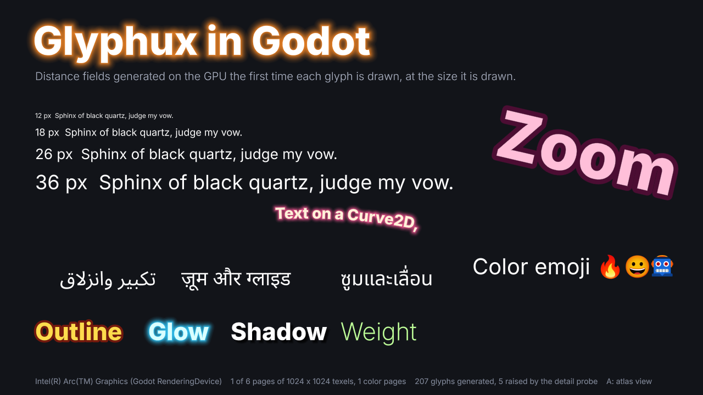
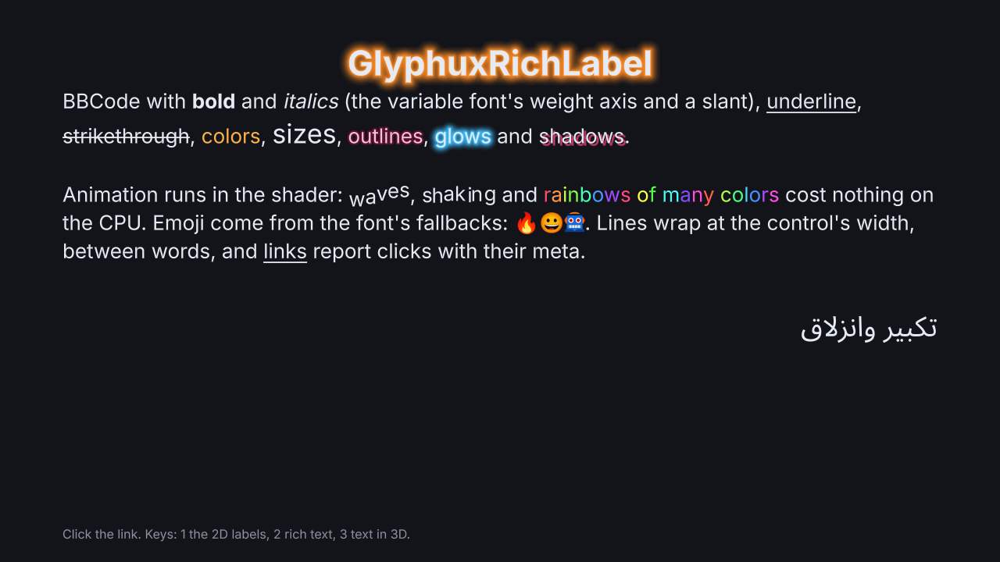
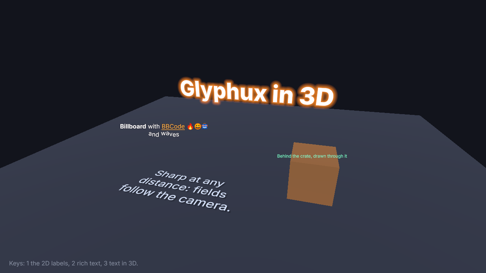

# Glyphux in Godot: demo

A Godot 4.6 project showing the [Glyphux addon](addons/glyphux) in three
scenes (keys 1, 2 and 3):

* `main.tscn`: `GlyphuxLabel` nodes with text in several scripts, a size ladder, text
  flowing along an animated `Curve2D`, color emoji from fallback fonts, outline, glow and
  shadow effects, a variable font's weight breathing from 100 to 900, and a label magnified
  from 3 to 120 pixels per em.
* `rich.tscn`: a `GlyphuxRichLabel` with BBCode: styles, sizes, effects, animated tags,
  emoji, a link and right-to-left text.
* `world.tscn`: `GlyphuxLabel3D` nodes in a 3D scene, with a camera flying around: on the
  floor, a billboard with BBCode, text showing through a crate.







## Run

From the repository root, build the addon's library, then open the project:

```
python examples/godot/addons/glyphux/build.py
godot --path examples/godot
```

The addon lives in this project, in `addons/glyphux/` (its library's crate is in
`addons/glyphux/rust/`); the build puts the library in its `bin/`, which git ignores. Run
the build command again after changing the addon.

In the first scene, the A key shows the atlas page that holds the generated fields; Page
Up and Page Down switch pages. `godot --path examples/godot -- --scene=world
--screenshot=out.png` opens a scene (`main`, `rich` or `world`), saves the window after
three seconds and quits; `--updates` prints how many times labels have updated, every 60
frames. In the first scene, `--atlas` starts with the atlas page shown and
`--start=SECONDS` that far into the animation.

The first time Godot opens the project, it imports the fonts. If that first run is a
headless `--import`, Godot may crash on exit after the import has completed. This also
happens with an empty godot-rust 0.5.5 extension. The next run starts normally.

## Fonts

The `fonts` folder contains some of the web demo's fonts, with their license files:

* `InterVariable-Latin.ttf`: Inter's variable font (weight and optical size axes), limited
  to ASCII. SIL Open Font License.
* `NotoSans*-Subset.ttf`: Noto Sans, only the characters the demo shows. SIL Open Font
  License.
* `Noto-COLRv1-Subset.ttf`: Noto Color Emoji (COLRv1), SIL Open Font License, and
  `Twemoji-Subset.ttf`: Twemoji Mozilla, font code Apache 2.0, artwork CC BY 4.0. Both are
  fallbacks of `inter_emoji.tres`. The robot comes from Twemoji: Noto's has a point where
  more paint regions meet than the color format holds, so the label falls back past it.
